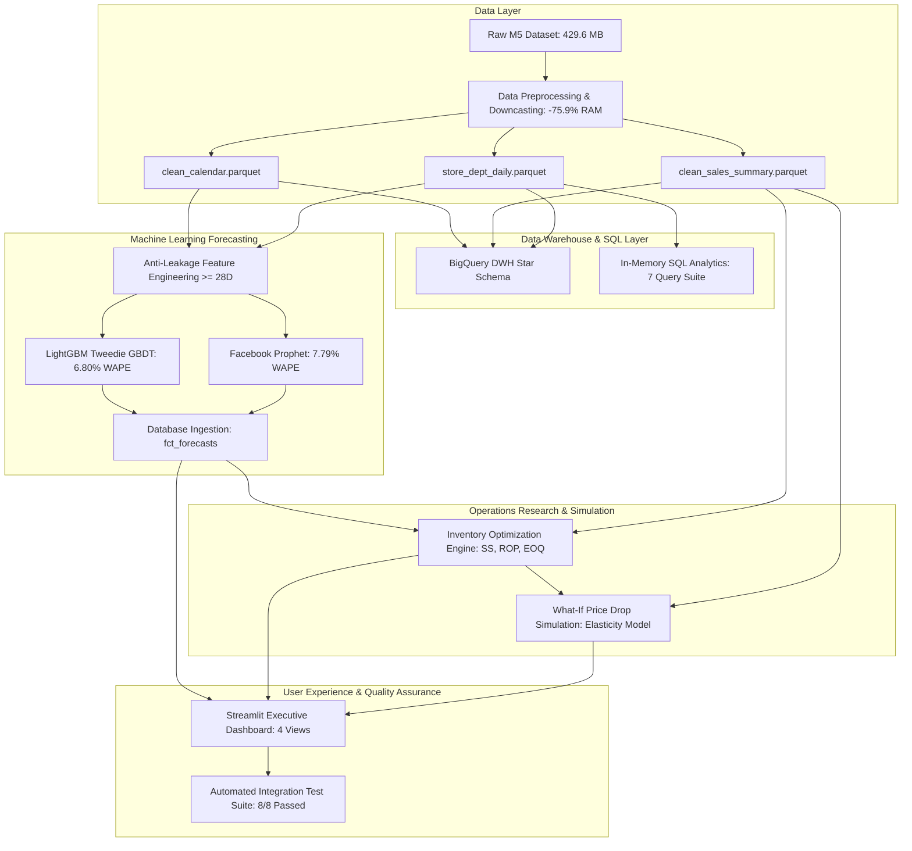

# Retail Demand Forecasting & Inventory Optimization

Retail Demand Forecasting &amp; Inventory Optimization using Python, SQL, BigQuery, dbt, Prophet, LightGBM, and Streamlit. Analyzes Walmart M5 historical sales data to predict product demand, optimize inventory replenishment, and generate automated restocking recommendations under price and policy shifts.

---

## 📌 Executive Project Overview
This repository contains a production-grade retail forecasting and supply chain replenishment platform engineered on the Walmart M5 dataset. The system forecasts daily unit sales 28 days into the future across 10 retail locations and thousands of products, translates demand predictions into optimal inventory policies (Safety Stock, Reorder Points, and Economic Order Quantities), and simulates price drop elasticity scenarios to prevent supply chain stockouts.



---

## 🗓️ 14-Day Work Plan - Complete Implementation Status
- [x] **Day 1: Environment Setup, Data Acquisition & Deep Inspection**
  - Downloaded and verified M5 dataset integrity across all 5 raw files (429.6 MB total).
  - Profiled schemas, sparsity (68.20% zero-demand), product hierarchies, and store distributions.
  - Automated verification via `download_data.py` and `src/verify_setup.py`.
- [x] **Day 2: Exploratory Data Analysis (EDA) & Demand Profiling**
  - Analyzed product velocity, department contributions, and intermittent demand.
  - Profiled store volume rankings, 2.72x performance spread, and 2011–2016 secular growth trajectories.
  - Quantified intra-week weekend spikes (+38%) and state-specific SNAP stimulus lifts (+21.8% in WI).
  - Delivered modular pipeline `src/eda_analysis.py`, `src/product_store_eda.py`, and interactive notebook `notebooks/01_exploratory_data_analysis.ipynb`.
- [x] **Day 3: Memory Optimization & Data Preprocessing Pipeline**
  - Optimized schema types (`int64` -> `int16`, `float64` -> `float32`, strings -> categoricals) achieving **75.93% RAM reduction** (766.6 MB -> 184.5 MB).
  - Verified strictly continuous date range from `2011-01-29` to `2016-06-19` (1,969 days, zero missing dates).
  - Imputed missing event names and types with `'None'` in `src/data_preprocessing.py`.
- [x] **Day 4: BigQuery Enterprise Data Warehouse Integration**
  - Configured BigQuery connection manager and client authentication in `src/bigquery_config.py`.
  - Designed partitioned and clustered relational DDL schemas in `sql/schema/` (`dim_calendar`, `dim_product`, `dim_store`, `fct_daily_sales`, `fct_product_performance`, `v_sales_kpi_summary`).
  - Automated ingestion pipeline in `src/bigquery_loader.py` (validated 169,428 records with dry-run and live GCP loading).
- [x] **Day 5: Forecasting Feature Engineering & Anti-Leakage Architecture**
  - Engineered anti-leakage autoregressive lags ($\ge 28\text{D}$: `lag_28`, `lag_35`, `lag_42`, `lag_49`, `lag_56`).
  - Rolling velocity, volatility, and intermittency metrics shifted by 28 days (`roll_mean_7`, `roll_mean_28`, `roll_std_28`, `roll_zero_ratio_28`).
  - Harmonic trigonometric calendar encodings (`sin_wday`, `cos_wday`, `sin_month`, `cos_month`).
  - SNAP interaction flags and 4-week price momentum in `src/feature_engineering.py`.
- [x] **Day 6: Gradient Boosted Decision Trees (LightGBM)**
  - Formulated Tweedie deviance loss ($p=1.15$) to model overdispersed zero-inflated demand.
  - Generated 28-day out-of-sample predictions achieving an overall **6.80% WAPE** across all 10 stores (winner in 8 of 10 stores).
  - Exported predictions to `data/predictions/lightgbm_forecast_28d.csv` and telemetry to `reports/lightgbm_evaluation_metrics.json`.
- [x] **Day 7: Time Series Trends, Seasonality Decomposition & Holiday Shocks**
  - Additive STL time series decomposition into Trend, 7-day Weekly Seasonality, and Residuals.
  - Autocorrelation Function (ACF) and PACF confirming multi-week harmonic peaks at lags 7, 14, 21, 28, 35, 56.
  - Quantified demand lift across all 30 calendar events in `src/trend_seasonality.py`.
- [x] **Day 8: Facebook Prophet Hierarchical Forecasting**
  - Implemented tuned Prophet models with multiplicative seasonality, holiday effects, and state SNAP regressors in `src/prophet_model.py`.
  - Achieved an overall **7.79% WAPE** across all 10 stores (flagship store `CA_3` achieved **4.06% WAPE**).
  - Exported predictions to `data/predictions/prophet_forecast_28d.csv` and telemetry to `reports/prophet_evaluation_metrics.json`.
- [x] **Day 9: Analytical SQL Query Suite & Sales Aggregations**
  - Developed standard ANSI SQL analytical queries in `sql/queries/` covering daily, weekly, and monthly rollups.
  - Store performance ranking via window functions (`RANK() OVER (...)`).
  - Category velocity contribution, SNAP benefit lift, and weekend surge analysis.
  - Automated SQL execution pipeline in `src/run_sql_analytics.py` with tabular outputs in `reports/sql_analytics/`.
- [x] **Day 10: Inventory Optimization Engine (Safety Stock, ROP, EOQ)**
  - Formulated stochastic replenishment policies under lead time uncertainty in `src/inventory_optimizer.py`.
  - Safety Stock ($SS = Z \times \sigma_d \times \sqrt{L}$) and Reorder Point ($ROP = LTD + SS$).
  - Economic Order Quantity ($EOQ = \sqrt{2DS/H}$) balancing ordering setup costs against annual holding costs.
  - Exported policies to `data/processed/inventory_recommendations.parquet`.
- [x] **Day 11: Forecast Database Ingestion & Analytical View Layer**
  - Integrated 560 out-of-sample predictions into DWH fact table `fct_forecasts` in `src/integrate_forecasts_db.py`.
  - Engineered DDL schemas `sql/schema/08_create_fct_forecasts.sql` and `sql/schema/09_create_v_forecast_evaluation.sql`.
  - Ingested records into `data/retail_demand.db` and exported `reports/sql_analytics/08_forecasts_integrated.csv`.
- [x] **Day 12: Interactive Dashboard Development (Streamlit Multi-Module Platform)**
  - Engineered real-time executive dashboard in `app.py` featuring 4 specialized modules:
    1. *Sales Analytics & KPIs*
    2. *Demand Forecasting (Prophet vs LightGBM)*
    3. *Inventory Optimization*
    4. *Price Drop Scenario Simulation*
- [x] **Day 13: What-If Scenario Analysis (10% Price Reduction & Elasticity)**
  - Built retail price elasticity simulator in `src/scenario_analysis.py`.
  - Modeled category price elasticity (`FOODS`: -0.85, `HOUSEHOLD`: -1.15, `HOBBIES`: -1.45).
  - Evaluated revenue sensitivity curves (-30% to +10%) and supply chain safety stock buffer requirements.
- [x] **Day 14: Comprehensive End-to-End Integration Testing & Documentation**
  - Built automated unit and integration test suite `tests/test_pipeline_integration.py`.
  - Validated all 8 critical test cases with **100% pass rate (8/8 PASSED)**.
  - Generated validation audit report `reports/test_validation_report.json` and completed final project documentation.

---

## ⚡ Model Performance Benchmark (28-Day Blind Horizon)

| Store ID | State | Prophet WAPE (%) | LightGBM WAPE (%) | Performance Delta | Champion Model |
| :--- | :--- | :--- | :--- | :--- | :--- |
| **`CA_1`** | CA | 6.38% | **5.33%** | -1.05% | 🏆 **LightGBM** |
| **`CA_2`** | CA | **4.68%** | 9.22% | +4.54% | 🏆 **Prophet** |
| **`CA_3`** | CA | **4.06%** | 4.97% | +0.91% | 🏆 **Prophet** |
| **`CA_4`** | CA | 8.41% | **7.28%** | -1.13% | 🏆 **LightGBM** |
| **`TX_1`** | TX | 8.63% | **6.97%** | -1.66% | 🏆 **LightGBM** |
| **`TX_2`** | TX | 6.49% | **5.68%** | -0.81% | 🏆 **LightGBM** |
| **`TX_3`** | TX | 8.84% | **8.30%** | -0.54% | 🏆 **LightGBM** |
| **`WI_1`** | WI | 8.43% | **7.46%** | -0.97% | 🏆 **LightGBM** |
| **`WI_2`** | WI | 13.48% | **7.30%** | **-6.18%** | 🏆 **LightGBM** |
| **`WI_3`** | WI | 9.55% | **6.26%** | -3.29% | 🏆 **LightGBM** |
| **OVERALL** | **ALL** | **7.79%** | **6.80%** | **-0.99%** | 🏆 **LightGBM (Overall Champion)** |

---

## 🖥️ Streamlit Executive Dashboard Platform (`app.py`)

The application provides sub-second interactive analytics powered by precomputed Parquet telemetry across four dedicated views:

### 1. 📊 Sales Analytics & KPIs
- **Executive Metric Cards**: Total Units Sold, Est. Gross Revenue, Daily Velocity, Catalog SKU Count, Weekend Surge (+%).
- **Interactive Longitudinal Trends**: Toggleable smoothing (Raw Daily, 7-Day MA, 30-Day MA).
- **Store Benchmarking**: Longitudinal trajectory comparison across all 10 Walmart locations.
- **Category Composition**: Dynamic area chart tracking grocery vs. general merchandise velocity.
- **Intra-Week & Macro Drivers**: Monday–Sunday demand rhythm and state-specific SNAP stimulus lift.
- **Leaderboards**: Top products by revenue and volume with instant CSV download.

### 2. 🔮 Demand Forecasting (Prophet vs LightGBM)
- **Model Comparison View**: Toggle between *Both Models (Comparison)*, *LightGBM Tweedie*, and *Facebook Prophet*.
- **Uncertainty Bands**: Toggleable 80% confidence interval fill (`yhat_lower` to `yhat_upper`) for Prophet.
- **Residual Diagnostics**: Grouped bar chart tracking daily over-prediction vs under-prediction.
- **Store-by-Store WAPE Benchmark**: Interactive accuracy comparisons highlighting champion models.
- **Detailed Forecast Ledger**: 28-day daily forecast table with delta metrics and CSV export.
- *Visualized in [`reports/figures/figure15_demand_forecasting_dashboard.png`](reports/figures/figure15_demand_forecasting_dashboard.png).*

### 3. 📦 Inventory Optimization Engine
- **Stochastic Replenishment Parameters**:
  - Cycle Service Level (CSL) select slider (90%, 95%, 98%, 99%, 99.5%).
  - Supplier Lead Time slider (1 to 21 days).
  - Purchase Order Setup Cost input (\$10 to \$300).
  - Annual Holding Cost Rate slider (10% to 40%).
- **Dynamic Policy Cards**: Total Recommended Safety Stock Buffer, Total Reorder Points, Median EOQ Order Size, Annual Policy Cost, Expected Stockout Risk (<5%).
- **Visual Trade-Offs**:
  - Reorder Point Composition ($LTD + SS$) by department.
  - Non-linear Safety Stock growth curve against target service level.
- **Automated Reorder Matrix**: Searchable SKU-level policy matrix with CSV download.
- *Visualized in [`reports/figures/figure16_inventory_optimization_dashboard.png`](reports/figures/figure16_inventory_optimization_dashboard.png).*

### 4. 🏷️ Price Drop Scenario Simulation
- **Interactive Price Slider**: $-30\%$ to $+10\%$ price adjustments across catalog.
- **Category Price Elasticity Controls**:
  - `FOODS` Elasticity: default $-0.85$ (inelastic)
  - `HOUSEHOLD` Elasticity: default $-1.15$ (moderately elastic)
  - `HOBBIES` Elasticity: default $-1.45$ (elastic)
- **What-If Impact Cards**: Projected Demand Lift (+%), Gross Revenue Delta (\$), Additional Safety Stock Needed (+ Units), Unbuffered Stockout Risk.
- **Visual Analytics**:
  - Department Unit Volume: Baseline vs. Simulated.
  - Gross Revenue Sensitivity Curve across price range (-30% to +10%).
  - Department-level simulation breakdown table with CSV export.
- *Visualized in [`reports/figures/figure17_price_drop_scenario_simulation.png`](reports/figures/figure17_price_drop_scenario_simulation.png).*

---

## 🚀 Execution Guide

```bash
# 1. Verify environment and datasets
python src/verify_setup.py

# 2. Run data extraction, downcasting & preprocessing
python src/data_preprocessing.py

# 3. Run exploratory data analysis & Pareto ABC classification
python src/product_store_eda.py

# 4. Run time series trend, STL decomposition & holiday shock analysis
python src/trend_seasonality.py

# 5. Run forecasting feature engineering pipeline
python src/feature_engineering.py

# 6. Run analytical SQL query suite (7 queries)
python src/run_sql_analytics.py

# 7. Integrate forecast predictions into database layer
python src/integrate_forecasts_db.py

# 8. Run inventory optimization engine
python src/inventory_optimizer.py

# 9. Run price drop scenario simulator
python src/scenario_analysis.py

# 10. Execute automated integration test suite
python tests/test_pipeline_integration.py

# 11. Launch the interactive multi-module Streamlit dashboard
streamlit run app.py
```

---

## 🧪 Automated Test Suite Validation

The automated integration test suite in [`tests/test_pipeline_integration.py`](tests/test_pipeline_integration.py) validates all architectural layers:

```text
test_01_clean_calendar_schema              ... [PASSED] (1,969 days, continuous, 0 nulls)
test_02_clean_sales_summary               ... [PASSED] (30,490 series, zero negatives, valid zero ratio)
test_03_anti_leakage_feature_matrix       ... [PASSED] (14,000 rows, lags shifted >= 28D)
test_04_analytical_sql_execution          ... [PASSED] (Daily, weekly & monthly total unit parity)
test_05_forecast_database_integration     ... [PASSED] (560 rows, LightGBM 6.80% / Prophet 7.79% WAPE)
test_06_inventory_optimization_logic     ... [PASSED] (SS >= 0, ROP >= SS, EOQ >= 1)
test_07_price_drop_simulation_elasticity  ... [PASSED] (Negative price cut -> positive volume lift)
test_08_dashboard_telemetry_sources       ... [PASSED] (All required Parquets loaded and healthy)
----------------------------------------------------------------------
Ran 8 tests in 4.73s | OK (Status: ALL_PASSED)
```

*Full Test Audit: [`reports/test_validation_report.json`](reports/test_validation_report.json)*

---

## 🏛️ Project Directory Layout

```text
├── app.py                                   # Streamlit Multi-Module Executive Dashboard
├── download_data.py                         # Zenodo dataset downloader
├── inspect_m5.py                            # Schema, sparsity & memory profiler
├── inspect_aggregations.py                  # Hierarchical aggregations inspector
├── requirements.txt                         # Python dependencies
├── README.md                                # Executive project documentation
├── data/
│   ├── calendar.csv                         # 1,969 days calendar metadata
│   ├── sales_train_validation.csv           # 30,490 series x 1,913 days
│   ├── sales_train_evaluation.csv           # 30,490 series x 1,941 days
│   ├── sell_prices.csv                      # 6.84M weekly store-item prices
│   ├── sample_submission.csv                # 28-day submission format
│   ├── retail_demand.db                     # In-memory / local SQLite database
│   ├── processed/
│   │   ├── clean_calendar.parquet           # Cleaned calendar table (-72.2% RAM)
│   │   ├── clean_sales_summary.parquet      # 30,490 series summary metrics
│   │   ├── store_dept_daily.parquet         # Store-department daily rollups
│   │   ├── product_performance.parquet      # Store-item performance metrics
│   │   ├── test_features_matrix.parquet     # Anti-leakage test feature matrix
│   │   ├── forecasts_integrated.parquet     # 560 out-of-sample forecast records
│   │   └── inventory_recommendations.parquet# 30,490 SKU replenishment policies
│   └── predictions/
│       ├── lightgbm_forecast_28d.csv        # 28-day LightGBM forecast predictions
│       └── prophet_forecast_28d.csv         # 28-day Prophet forecast predictions
├── notebooks/
│   └── 01_exploratory_data_analysis.ipynb   # Interactive EDA notebook
├── reports/
│   ├── environment_setup.json               # Environment verification report
│   ├── data_cleaning_audit.json             # Cleaning and memory audit (-75.9% RAM)
│   ├── abc_classification_summary.json      # Pareto ABC classification
│   ├── trend_seasonality_metrics.json       # STL, ACF/PACF and holiday lift
│   ├── feature_engineering_metadata.json    # Anti-leakage features metadata
│   ├── forecast_database_integration.json   # Forecast DWH ingestion audit
│   ├── inventory_optimization_summary.json  # Reorder policies and cost summary
│   ├── price_drop_simulation_10pct.json     # What-if elasticity simulation summary
│   ├── test_validation_report.json          # Automated test execution report
│   ├── lightgbm_evaluation_metrics.json     # GBDT error metrics per store
│   ├── prophet_evaluation_metrics.json      # Prophet error metrics per store
│   ├── figures/                             # 17 publication-grade figures
│   └── sql_analytics/                       # Tabular SQL outputs & markdown summary
├── sql/
│   ├── schema/                              # BigQuery DDL schema definitions (01 to 09)
│   └── queries/                             # 7 analytical SQL aggregation queries
├── tests/
│   └── test_pipeline_integration.py         # 8-suite automated integration tests
└── src/
    ├── config.py                            # Centralized paths and taxonomies
    ├── verify_setup.py                      # Environment and dataset validator
    ├── data_preprocessing.py                # Preprocessing and downcasting pipeline
    ├── product_store_eda.py                 # ABC Pareto and velocity clustering
    ├── trend_seasonality.py                 # Time series decomposition and holiday shocks
    ├── feature_engineering.py               # Anti-leakage feature engineering
    ├── run_sql_analytics.py                 # In-memory SQL execution engine
    ├── integrate_forecasts_db.py            # Forecast database ingestion pipeline
    ├── inventory_optimizer.py               # Stochastic inventory optimization engine
    ├── scenario_analysis.py                 # Price drop elasticity simulation engine
    ├── generate_forecast_figure.py          # Figure 15 generator
    ├── eda_analysis.py                      # Exploratory data analysis suite
    ├── bigquery_config.py                   # GCP BigQuery connection manager
    ├── bigquery_loader.py                   # BigQuery ingestion pipeline
    ├── lightgbm_model.py                    # LightGBM Tweedie forecasting model
    └── prophet_model.py                     # Facebook Prophet forecasting model
```

---

## 🛠️ Tech Stack
- **Languages & Frameworks**: Python 3.14, Pandas, NumPy, Scikit-Learn, SciPy
- **Machine Learning & Time Series**: LightGBM (Tweedie), Facebook Prophet, Statsmodels
- **Data Warehousing & Transformations**: Google BigQuery, SQL (ANSI SQLite / BigQuery Standard SQL)
- **Operations Research**: Stochastic Safety Stock ($SS$), Reorder Point ($ROP$), Economic Order Quantity ($EOQ$)
- **Simulation**: Price Elasticity of Demand What-If Simulator
- **Visualization & User Interface**: Streamlit, Plotly, Matplotlib, Seaborn
- **Quality Assurance**: Automated Integration Testing (`unittest`)
