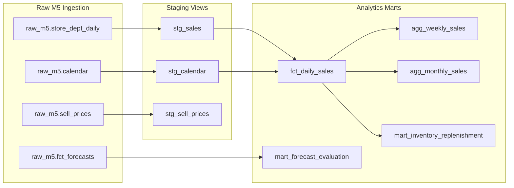

# dbt Transformation Layer: Retail Demand Forecasting & Inventory Optimization

This directory contains the production **dbt (Data Build Tool)** project for the Walmart M5 Retail Demand Forecasting & Inventory Optimization platform.

---

## 🏛️ dbt Data Architecture & Lineage

The transformation layer is structured into a modular dimensional modeling pipeline:



---

## 📁 Directory Structure
```text
dbt/
├── dbt_project.yml              # Main dbt configuration and model materializations
├── profiles.yml                 # Connection profile for BigQuery / Snowflake / DuckDB
├── README.md                    # Data lineage and documentation
└── models/
    ├── staging/
    │   ├── stg_calendar.sql     # Cleans calendar dates, holiday event flags, and SNAP indicators
    │   ├── stg_sales.sql        # Standardizes daily store-department units
    │   ├── stg_sell_prices.sql  # Weekly sell prices and estimated unit costs
    │   └── staging_schema.yml   # Sources and staging data quality tests
    └── marts/
        ├── fct_daily_sales.sql  # Daily partitioned and clustered transaction fact table
        ├── agg_weekly_sales.sql # Weekly rollups with WoW growth rates
        ├── agg_monthly_sales.sql# Monthly rollups with MoM metrics
        ├── mart_inventory_replenishment.sql # Safety stock, ROP, and EOQ calculations
        ├── mart_forecast_evaluation.sql    # Model evaluation (LightGBM vs Prophet vs Actuals)
        └── marts_schema.yml     # Mart column definitions, descriptions, and integrity tests
```

---

## 🚀 Execution & Testing Commands

```bash
# 1. Install dbt-bigquery dependencies
pip install dbt-bigquery

# 2. Test connection to Data Warehouse
dbt debug --profiles-dir .

# 3. Compile dbt models
dbt compile --profiles-dir .

# 4. Run full transformation pipeline
dbt run --profiles-dir .

# 5. Execute data quality tests (unique, not_null, accepted_values)
dbt test --profiles-dir .

# 6. Generate and view interactive data lineage documentation
dbt docs generate --profiles-dir .
dbt docs serve
```
